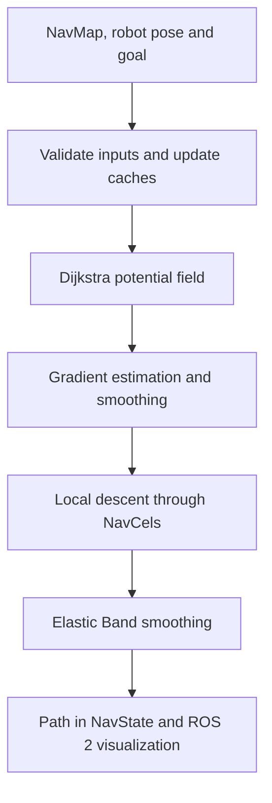

# EasyNav Gradients

Gradient-based global path planning on triangular navigation meshes for EasyNav and ROS 2 Jazzy.

Developed by Marvin Pancracio Manso as part of a Robotics Engineering bachelor's thesis at Universidad Rey Juan Carlos (URJC), this C++ planner extends the EasyNav NavMap A* planner into a potential-field and gradient-descent approach.

**Status:** private pre-release. The original planner has been functionally validated by its author; an isolated ROS 2 Jazzy Docker build and package installation were verified by its author on 2026-11-25. Eight automated plugin and synthetic mesh tests passed in the maintainer's Docker build. CI build confirmation, broader regression testing and attribution review are pending.

## Features

- Goal-rooted Dijkstra potential propagation over traversable NavCel transitions.
- Local gradient estimation and neighborhood smoothing.
- Neighbor selection combining gradient alignment with strictly decreasing potential.
- Deterministic lower-potential fallback for near-zero gradients or unsuccessful gradient transitions.
- Cached topology, centroids, traversable transitions and potential/gradient fields.
- Geometry/topology and goal-change detection, including orientation-only goal updates.
- Elastic Band waypoint smoothing constrained to associated triangles.
- ROS 2 pluginlib integration and optional path/potential visualization (when subscribed).

## How it works



The potential and gradient fields are reused when the map and goal position remain unchanged. With continuous replanning disabled, the current path may also be reused. See [algorithm documentation](docs/algorithm.md) for the mathematical formulation and known limitations.

## Requirements

- Ubuntu 24.04 and ROS 2 Jazzy.
- C++23 compiler, CMake >= 3.20, colcon and ament_cmake.
- Compatible [EasyNavigation](https://github.com/EasyNavigation/EasyNavigation), [NavMap](https://github.com/EasyNavigation/NavMap) and [easynav_plugins](https://github.com/EasyNavigation/easynav_plugins) source packages.
- Dependencies declared in [package.xml](package.xml).

The source dependency manifest pins the four Git revisions resolved in the successful local Docker build. The ROS base image and apt packages are not digest/version-locked.

## Build

For an isolated build without an existing host ROS workspace, see [Docker instructions](docker/README.md). The tested source revisions are in [easynav_gradients.repos](easynav_gradients.repos); a fresh CI build using the pinned manifest remains to be verified.

In an existing compatible ROS 2 workspace, clone this repository under src (do not keep two packages named easynav_gradients in one workspace):

```bash
cd ~/workshop_ws/src
git clone https://github.com/mpancracio2020/easynav_gradients.git
cd ~/workshop_ws
source /opt/ros/jazzy/setup.bash
rosdep install --from-paths src --ignore-src -r -y
colcon build --packages-up-to easynav_gradients --symlink-install
source install/setup.bash
ros2 pkg prefix easynav_gradients
```

Access to the private repository is required until publication. rosdep may require additional upstream packages to be present in the workspace.

For a separate overlay and exact dependency capture, see [installation guide](docs/installation.md).

## Integration

Register the planner in the existing EasyNav planner configuration using:

| Property | Value |
| --- | --- |
| ROS package | `easynav_gradients` |
| Plugin identifier | `easynav_navmap_gradients/GradientPlanner` |
| C++ class | `easynav::navmap::GradientPlanner` |
| Base class | `easynav::PlannerMethodBase` |

Use [config/params.yaml](config/params.yaml) as the parameter reference. Its plugin instance is named `gradients`; match that name to the instance in your EasyNav configuration. This repository is a planner plugin, not a standalone navigation stack. It requires an existing EasyNav bringup that supplies the NavMap, robot pose and goals.

See [usage guide](docs/usage.md) for runtime integration and [parameter reference](docs/parameters.md) for tuning and validation details.

## Validation

The Docker build runs eight automated tests covering plugin loading, initialization, connected and disconnected meshes, path reuse, topology changes and goal orientation. The maintainer reported 8/8 passing (153 ms total). Full bringup and independent collision-clearance validation remain pending.

The metadata workflow checks package and plugin XML, baseline parameter values, citation metadata and Python syntax. See the [release validation checklist](docs/release-validation.md). A successful metadata check is not a ROS build or a functional test.

## Benchmarks

The original thesis baseline writes function timings to `/tmp/gradient_planner_profile.csv` and planning metrics to `/tmp/planner_metrics.csv`. See [benchmark instructions](benchmarks/README.md). The raw thesis datasets are not yet included; no numerical performance claims are made here.

## Known limitations

- The width filter is a shared-edge heuristic, not a full robot-footprint collision check.
- Constraining individual waypoints to their triangles does not prove that the entire smoothed path is collision-free.
- Start localization can fall back to the nearest NavCel; the goal must be contained in the map.
- Cached paths can persist when goals are removed or input data becomes invalid.
- CSV instrumentation is enabled in the original baseline and adds overhead.
- The example node is not an automated integration test.

Validate paths in simulation before deployment on hardware.

## Citation and acknowledgments

See [CITATION.cff](CITATION.cff) for software citation metadata.

The implementation was adapted from the EasyNav NavMap A* planner in [easynav_plugins](https://github.com/EasyNavigation/easynav_plugins). We acknowledge the EasyNavigation and NavMap contributors whose framework and planner provided the foundation for this work. See [NOTICE](NOTICE) and [licensing review](docs/licensing.md).

## License

Apache License 2.0 is the intended release license. See [LICENSE](LICENSE). Source headers have been aligned based on the author's confirmation that the source A* planner used Apache-2.0. Exact upstream revision, copyright and NOTICE verification remain release gates; this snapshot is not yet cleared for public distribution.
